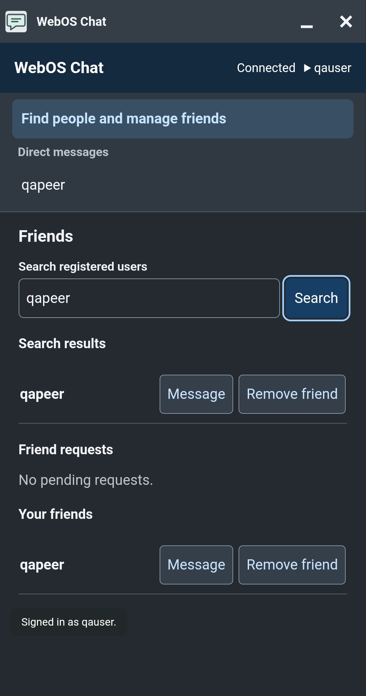
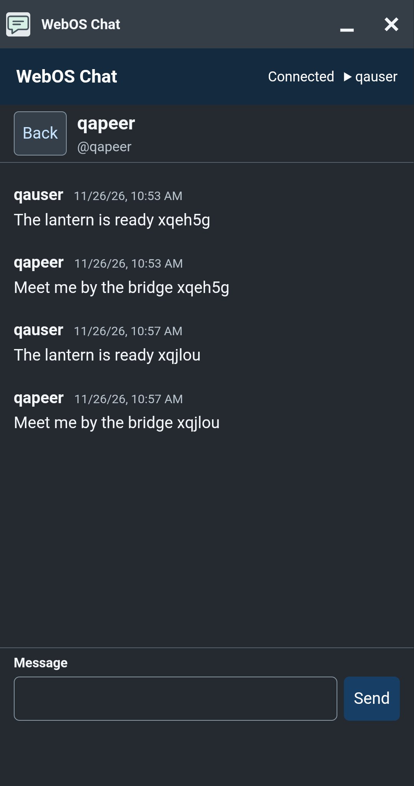

# WebOS Chat on the Galaxy S10+

Launch **System Tools → WebOS Chat** while signed in. Search a registered
account, accept the friend request on that account, and open Message.
Send a short message, read the reply and tap Back to find the conversation
again. Refresh WebOS and reopen the same conversation from Direct messages.

The baseline app delivered both messages, but dark-mode headings and usernames
were nearly white on white. On the phone with the keyboard open, the message
history was 68 CSS pixels high. The compact layout now gives the thread the
full app area, returns to people and conversations with Back, and keeps the
keyboard closed until the user taps the composer.

## Tested workflow

The phone baseline covers three of seven workflow groups: finding an accepted
contact, exchanging live direct messages, and reopening the history after
refresh. The initial physical replay also made and accepted the friend request.
The other groups are friend cancellation and removal, profile editing, unread
and older-history navigation, and archived or interrupted conversations.
The tested flow meets the phone target of two groups. Chat stores its own
history and has no editable file or export workflow.

The disposable sender typed “The lantern is ready” with a run identifier.
The other session received those exact words and sent back “Meet me by the
bridge” with the same identifier. The sender saw the reply live, reopened
both messages after refresh, and minimized the app to restore the launcher.
On the S10+ in Chrome 158.0.8127.92, the keyboard-open history measured
173 CSS pixels high. The message field and Send remained above the keyboard.
Back and Send each measured 44 CSS pixels. The conversation text contrast was
13.32:1. The phone screenshots contain synthetic accounts and messages.

Chromium 158.0.8127.36 at 820 and 1300 CSS pixels exchanged and reopened the
same messages and kept the sidebar and WebOS app bar in view. Three of seven
desktop workflow groups ran in this browser pass. The desktop benchmarks for
profile changes, contact removal, unread and older-history controls, and
archive or disconnect recovery are still open.

All six Chat backend tests passed, including membership checks, idempotency,
username reuse and survival of the remaining participant's archived history.
Retirement and reconnection were covered by the backend tests and earlier
detached trials.

## Source and launch

The browser code tested was `2f75600`. The test viewer was
`97a1929f788bda147b77767930175774fc575c6c15986a8a9f47095a6b709c4a`.
Use the existing WebOS viewer builder with `--webos-chat enabled`. It packages
`registered.mjs` as `index.mjs` alongside `registered.css`, `style.css` and
`transport.mjs`. Run it with a signed WebOS account and a private test backend
with `WEBOS_REGISTERED_CHAT=1`. The standalone demo in the repository does not
use the registered server.

[WebOS release and rollback](https://github.com/CC-David-CC/WebOS/blob/webos/chat-phone-workflow/deploy/ACTIVE-RELEASE.md#webos-chat-phone-conversations-and-dark-controls)
